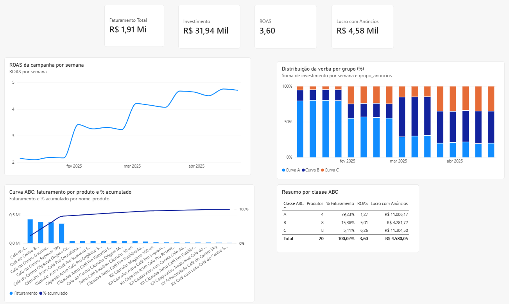

# Curva ABC + Google Shopping: otimização de ROAS com SQL e Power BI

Análise de **Curva ABC** de produtos da loja on-line da **Gran Coffee** (marcas Café do Centro e Astro Café), usada para estruturar uma **campanha de Google Shopping** e decidir, semana a semana, **quanto investir em cada grupo de produtos e quais produtos colocar em cada grupo**.

> **Caso real**, conduzido por mim na Gran Coffee, onde atuei como Analista de Dados e Performance. Os **produtos e preços são os reais**, retirados do site da loja. Os dados de **custo, vendas e Google Ads são simulados** para preservar as informações da empresa, mas reproduzem a estrutura da campanha, a lógica de decisão e o comportamento observado na prática.



---

## Contexto

- **Fontes de dados:** vendas da loja própria (**VTEX**) e do **Mercado Livre**, além dos dados de investimento e conversão do **Google Ads**.
- **Campanha:** uma única campanha de **Google Shopping** com três grupos de anúncios: **Curva A**, **Curva B** e **Curva C**.
- **Objetivo:** aumentar o **ROAS** da campanha sem perder volume de vendas.

## Os grupos de produtos

| Curva | Produtos | Perfil |
|---|---|---|
| **A** | Cafés em grãos 1kg Café do Centro (Superior, Barista Gourmet, Gourmet Brasileiro, Barista Prime) | Os mais procurados, vendas constantes ao consumidor final |
| **B** | Cápsulas Café do Centro (10 un.) e Astro Café (10 e 50 un.) | Procura boa e margem um pouco melhor: a curva equilibrada |
| **C** | Kits de cápsulas Astro Café (100 un.) e kits de bebidas Café do Centro 5kg | Pouca saída, mas quando vendem pela campanha trazem o melhor retorno |

## O problema

Os produtos **A** (os mais procurados e mais vendidos) concentram as vendas, mas o retorno dos anúncios neles é baixo. Já os produtos **C** vendem menos, mas cada venda gerada pelo anúncio traz um retorno bem maior. Os produtos **B** ficam no meio: são conhecidos, têm saída constante e retorno equilibrado.

Concentrar a verba nos produtos mais vendidos parecia o caminho natural, mas não era o que dava o melhor ROAS.

## A estratégia

1. **Classificação ABC:** consolido as vendas das duas plataformas e classifico os produtos pelo faturamento acumulado.
   - **A:** até 80% do faturamento
   - **B:** de 80% a 95%
   - **C:** os 5% finais
2. **Estrutura da campanha:** cada classe vira um grupo de anúncios dentro da campanha de Shopping.
3. **Rotina semanal:** acompanho o ROAS de cada grupo e redistribuo a verba para onde o retorno está crescendo.
4. **Revisão da seleção de produtos:** além da verba, ajusto quais produtos ficam em cada grupo. Um produto pode subir de grupo quando ganha volume, ou ser pausado quando o anúncio custa mais do que a venda deixa.

## Resultados (dados simulados, 16 semanas)

**Evolução da campanha:**

| Semanas | Divisão da verba (A / B / C) | O que mudou | ROAS da campanha |
|---|---|---|---|
| 1–4 | 80% / 15% / 5% | Foco nos produtos mais vendidos | ~2,1 |
| 5–8 | 55% / 20% / 25% | Curva C em alta: mais verba para C | ~3,3 |
| 9–11 | 30% / 55% / 15% | Foco na curva B; Kit Mogiana 100 un. sobe para o grupo B e Bourbon 10 un. desce para o C | ~4,1 |
| 12–16 | 20% / 45% / 35% | Equilíbrio entre B e C | ~4,7 |

**Comparação entre as classes:**

| Classe | Produtos | % do faturamento | ROAS no Shopping | Lucro com anúncios* |
|---|---|---|---|---|
| **A** | 4 | 79,2% | 1,27 | −R$ 11,0 mil |
| **B** | 8 | 15,4% | 5,01 | +R$ 4,3 mil |
| **C** | 8 | 5,4% | 6,26 | +R$ 11,3 mil |

\* *Lucro com anúncios = valor das vendas geradas pelo Shopping × margem bruta − investimento.*

**Principais leituras:**

- A **curva A** responde por quase 80% do faturamento, mas o anúncio nesses produtos **dá prejuízo**: eles venderiam de qualquer forma, e cada real investido traz pouco retorno.
- As curvas **B e C** juntas tiveram o melhor desempenho: ROAS acima de 5 e lucro positivo. A **C**, mesmo com apenas 5% do faturamento, foi a que mais deu lucro com anúncios.
- Tirar verba da curva A e redistribuí-la entre B e C, ajustando também a seleção de produtos, levou o ROAS da campanha de **~2,1 para ~4,7**.

## Painel no Power BI

O painel se conecta direto ao banco no SQL Server e reúne a análise em uma tela:

- **Indicadores gerais:** faturamento total (R$ 1,91 milhão), investimento em Shopping (R$ 31,9 mil), ROAS (3,60) e lucro com anúncios (R$ 4,6 mil).
- **ROAS da campanha por semana:** mostra a subida de ~2,1 para ~4,7 em degraus, a cada mudança na divisão da verba.
- **Distribuição da verba por grupo (%):** colunas 100% empilhadas mostrando a verba saindo da curva A e indo para B e C. Lido junto com o gráfico de ROAS, mostra causa e efeito.
- **Gráfico de Pareto:** faturamento por produto, do maior para o menor, com o percentual acumulado. Os 4 cafés em grãos (curva A) já somam cerca de 80%.
- **Resumo por classe ABC:** produtos, % do faturamento, ROAS e lucro com anúncios de cada classe.

**Modelo de dados:** as tabelas `vendas_semanais` e `google_shopping_semanal` se ligam a `produtos` pelo `sku`, e `produtos` se liga à view `vw_curva_abc` (1:1). As métricas são medidas em DAX:

```
Faturamento Total  = SUM(vendas_semanais[faturamento])
Investimento       = SUM(google_shopping_semanal[investimento])
Valor Conversão    = SUM(google_shopping_semanal[valor_conversao])
ROAS               = DIVIDE(SUM(google_shopping_semanal[valor_conversao]), SUM(google_shopping_semanal[investimento]))
Lucro com Anúncios = SUM(vw_curva_abc[lucro_anuncios])
```

## Estrutura do repositório

```
curva-abc-produtos-sql/
├── curva_abc_shopping.pbix           # painel do Power BI
├── painel_curva_abc.png              # print do painel
├── dados/
│   ├── produtos.csv                  # 20 produtos reais da loja: preço de venda (real) e custo (simulado)
│   ├── vendas_semanais.csv           # vendas por semana, produto e plataforma (VTEX / Mercado Livre)
│   └── google_shopping_semanal.csv   # investimento e conversão por semana, produto e grupo
└── sql/
    ├── 01_criar_tabelas.sql
    ├── 02_inserir_dados.sql
    ├── 03_curva_abc.sql                  # view com classe ABC, ROAS e lucro com anúncios
    ├── 04_resumo_por_classe.sql          # comparação entre A, B e C
    ├── 05_acompanhamento_semanal.sql     # ROAS e % da verba por grupo, semana a semana
    └── 06_revisao_selecao_produtos.sql   # sugestão por produto: manter, mudar de grupo ou pausar
```

## Como rodar

1. Abra o **SQL Server Management Studio (SSMS)**.
2. Execute os scripts da pasta `sql/` **na ordem** (01 → 06).
3. A meta de ROAS fica no início do script `06` e pode ser ajustada.
4. Para o painel, abra o `curva_abc_shopping.pbix` no **Power BI Desktop**. Se o nome do seu servidor for diferente, ajuste em **Transformar dados → Configurações da fonte de dados**.

## Técnicas de SQL usadas

- `JOIN`, `LEFT JOIN` e `GROUP BY` para consolidar vendas, custos e dados de mídia
- **CTEs** (`WITH`) para organizar as análises em etapas
- **Funções de janela:** `SUM() OVER (ORDER BY ...)` para a curva acumulada, `PARTITION BY` para o % da verba por semana e `LAG()` para comparar com a semana anterior
- `CASE WHEN` para a classificação ABC e as recomendações
- `COALESCE` e `NULLIF` para tratar nulos e evitar divisão por zero
- **View** (`vw_curva_abc`) reaproveitada nas outras análises

## Ferramentas

- SQL Server Express e SQL Server Management Studio (SSMS)
- Power BI Desktop (modelagem de dados e DAX)

## Próximos passos

- Análise separada por plataforma de venda (VTEX × Mercado Livre)
